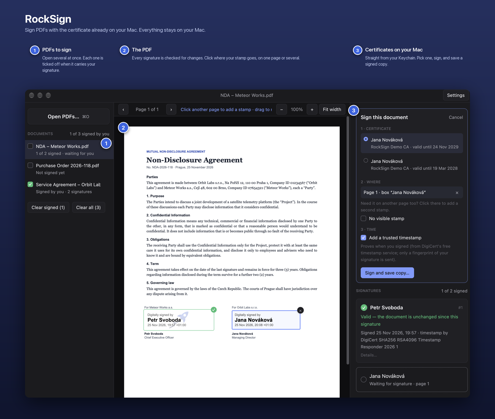

# RockSign


A small, native Mac app for signing PDFs with the certificate in your macOS Keychain, and for
checking who signed a PDF and whether it changed afterwards. It's built for the common
case where a few people sign the same document in turn and pass it on by email.

<p align="center">
  
  <br><sub>Shown with made-up documents and certificates (<code>rocksign --demo</code>).</sub>
</p>

> **Everything stays on your Mac.** RockSign only makes signing simpler. It adds no service in
> between.
>
> - **It uses the certificates already in your Keychain.** You import nothing into RockSign.
>   Your private key never leaves the Keychain: macOS does the signing, after asking you.
> - **Your documents stay where they are.** RockSign reads the PDF you open and writes the
>   signed copy where you choose. It doesn't upload, collect or keep anything about your
>   documents.
> - **There's no account, cloud, tracking or update check.** The only network request is the
>   optional trusted timestamp. It sends a fingerprint (hash) of the signature, not the document,
>   to DigiCert's free timestamp service. Turn it off in Settings and RockSign never goes online.
> - **It only remembers your preferences,** such as the file-name text, which certificates to
>   show and the stamp logo. They're kept in `~/Library/Application Support/RockSign`.

- Opens several PDFs at once. The list on the left ticks off the ones you've signed.
- Shows every signature, and warns in amber or red if a document was edited after it was signed.
- Signs with your Keychain certificate (PAdES, with a trusted timestamp), with a visible stamp
  you place on the page. You can put stamps on several pages, or sign into a prepared box.
- Saves a signed **copy**. The original stays untouched, and earlier signatures stay valid.
- Written in Rust with [GPUI](https://gpui.rs). Pages are drawn by Apple's PDFKit, with no
  browser engine inside.

Requires macOS 12 or newer, on Apple Silicon or Intel.

## Install

1. Download the latest `RockSign-….dmg` from
   [Releases](../../releases/latest).
2. Open it, then drag **RockSign** onto **Applications**.
3. Open RockSign from Applications. The first time, macOS says it *"could not verify RockSign is
   free of malware"*. That's because the app isn't signed with a paid Apple developer certificate,
   not because something is wrong with it. To open it anyway:
   - Click **Done**, then open **System Settings → Privacy & Security**.
   - Scroll down to *"RockSign was blocked…"*, click **Open Anyway** and confirm with your password.

   Or run this once in Terminal:

   ```sh
   xattr -dr com.apple.quarantine /Applications/RockSign.app
   ```

   You do this once for each new version.
4. A short welcome walks you through choosing your certificate, how signed copies are named, and
   an optional stamp logo. RockSign → *Set Up RockSign…* brings it back later.
5. The first time you sign, macOS asks whether RockSign may use your certificate's key. Enter your
   login password and choose **Always Allow**. After an update, macOS asks once more.

To update, download the new version and replace the app in Applications. Your settings are kept.

**Verify a download (optional).** Every release is built by GitHub Actions from this repository's
source and carries a signed build attestation. With the [GitHub CLI](https://cli.github.com):

```sh
gh attestation verify RockSign-0.1.0.dmg --repo ProRocketeers/rocksign
```

A `.sha256` checksum is attached to each release as well.

RockSign also shows up in Finder's **Open With** menu for PDFs, without becoming your default PDF
app.

## Using it

**Signing in turn.**

1. Open the PDF and click **Sign this document** (⌘S).
2. Pick your certificate, then drag a box where your stamp should go. You can also just click for
   the standard size, or click an empty signature box someone prepared.
3. Click **Sign and save copy…**.
4. Send the new file to the next person. They open it, see your signature as unchanged, sign it
   and pass it on. Each signature is appended to the file, so earlier ones stay valid.

Need your stamp on several pages, say pages 2 and 4? Click or drag on each page before signing.
Each stamp becomes its own signature, and all of them are saved together in one copy:

- Dragging again on a page moves that page's stamp.
- **×** removes a stamp.

Two rules:

- Sign the file you received.
- Never re-save the PDF in Preview or "Print to PDF" it. That rewrites the file and breaks every
  signature.

**What the colours mean.**

- **Green**: unchanged since signing (or only signatures were added since), and the certificate
  is trusted.
- **Amber**: unchanged, but the certificate isn't trusted on this Mac; or form fields or comments
  were changed after signing.
- **Red**: the signed content was changed, or the signature is broken.

**Czech qualified certificates** (PostSignum, I.CA, eIdentita, NCA, Komerční banka) are trusted
out of the box. RockSign ships the certificate authorities from the official Czech trusted list
(tsl.gov.cz), which macOS itself doesn't trust. For any other issuer, open a signature's details
and use **Trust "…" on this Mac** once, after checking the fingerprint.

**Is it a real signature?** Yes. It's a standard PAdES signature that Adobe Acrobat and other
validators check. With a qualified certificate kept in the Keychain (for example PostSignum), it's
an advanced electronic signature based on a qualified certificate. In Czech law that's a
*uznávaný elektronický podpis*. It is not a *qualified* electronic signature (QES): that needs the
key on a certified device such as a smart card.

**Files.** Open or drop several PDFs at once.

- ⌘] and ⌘[ move between them.
- **Clear signed** and **Clear all** under the list take files off it. ⌘⌫ removes the open one.
  Nothing is deleted from disk.

**Pages.** Scroll, or use Space / ⇧Space, ↑ ↓, ← → and Home / End. Zoom with ⌘+ / ⌘− / ⌘0.

**Settings (⌘,).**

- *General:* the text added to signed copies' file names, and whether to add a timestamp. The
  placeholders are `{n}` (how many people have signed), `{total}`, `{name}` and `{date}`; the
  default is ` (signed {n})`.
- *Stamp:* an optional logo. There's none by default; choose the RockSign rocket or your own
  PNG / JPEG / SVG. Show it as a faded watermark behind the text or above it, and set the
  watermark's opacity, position and size.
- *Certificates:* which ones appear when signing, and the default.

**Timestamps.** These come from DigiCert's free RFC 3161 service, and only a hash of the signature
is sent. Set `ROCKSIGN_TSA_URL` to use another service.

## Build from source

You need the Xcode command line tools (`xcode-select --install`) and
[Rust](https://rustup.rs). The right Rust version is picked up from `rust-toolchain.toml`.

```sh
cargo run --release -- "Contract.pdf"      # run it
scripts/bundle.sh                          # dist/RockSign.app and dist/RockSign-<version>.dmg
scripts/bundle.sh --universal              # Apple Silicon + Intel (rustup target add x86_64-apple-darwin)
```

An app you build yourself isn't quarantined, so the first-launch step above doesn't apply.

Useful from the terminal:

```sh
cargo test --workspace                            # signing chains, tampering, prepared boxes…
cargo run -- --list-certs                         # certificates RockSign can sign with
cargo run -- --check "Contract (signed 1).pdf"    # signatures and their trust
cargo run -p rocksign-core --example inspect -- "Contract (signed 1).pdf"
cargo run -p rocksign-core --example update_cz_trusted_list   # refresh the Czech CAs
cargo run --release -- --demo <folder>      # made-up PDFs and certificates, for screenshots (src/demo.rs)
```

**Layout.**

- `crates/rocksign-core` has no platform code, so a future server can reuse it. It covers:
  - PDF parsing and incremental updates;
  - CMS/PAdES signing and verification (RustCrypto);
  - the check for what changed after each signature;
  - the stamp.
- `src/` is the Mac app: the GPUI interface, PDFKit rendering, Keychain signing, trust evaluation
  and the timestamp client.
- `packaging/macos/` holds the Info.plist and app icon. `scripts/make-icon.sh` rebuilds
  `AppIcon.icns` from `AppIcon.svg`.

## Releasing

Every push and pull request runs formatting, lint and test checks, and builds the app
(`.github/workflows/ci.yml`). The disk image is kept for a week under the run's *Artifacts*.

To publish a version:

1. Set `version` in the top-level `Cargo.toml` (for example `0.2.0`) and commit.
2. Tag the commit and push the tag:

   ```sh
   git tag v0.2.0
   git push origin v0.2.0
   ```

`.github/workflows/release.yml` then:

1. runs the tests;
2. builds a universal app;
3. attests the build;
4. publishes a GitHub Release with the `.dmg`, its checksum, install notes and the changes since
   the last tag.

Builds for public repositories run on GitHub's macOS machines at no cost.

**Signing with an Apple Developer ID (optional, $99/year).** A Developer ID lets the app open
with a double-click instead of the *Open Anyway* step. It also keeps the Keychain's
*Always Allow* across updates. `scripts/bundle.sh` already signs with the hardened runtime when
`SIGN_IDENTITY` names a "Developer ID Application" certificate. What remains is importing that
certificate in the release workflow, and notarizing the `.dmg` with `xcrun notarytool`.

## License

[MIT](LICENSE).
